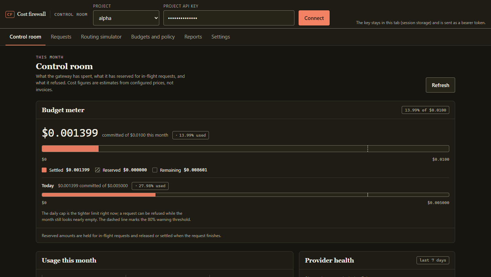
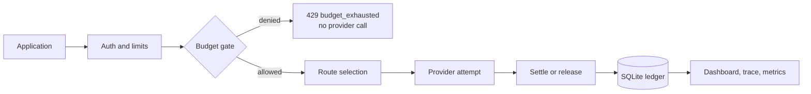
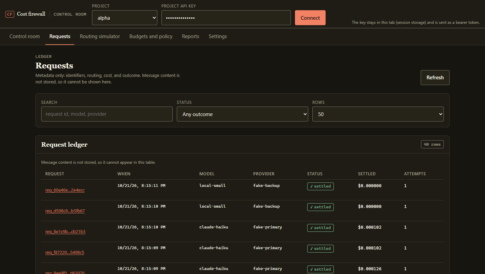

# AI Gateway Cost Firewall

[](https://github.com/r-bug-r/ai-gateway-cost-firewall/actions/workflows/ci.yml)
[](LICENSE)
[](pyproject.toml)

**A self-hostable, OpenAI-compatible gateway that refuses the request before it can
overspend.** It reserves each request's worst-case cost in SQLite, forwards only if the
reservation fits the budget, settles at the provider-reported usage, and records every
attempt and refusal.



It sits between your application and one or more model providers and does four things:

1. **Authenticates** each request against a project (tenant) and resolves its policy.
2. **Reserves** budget atomically in SQLite, then **settles** it at the provider-evidenced cost.
3. **Routes** to an ordered list of provider targets, falling back only for idempotent
   requests that failed with a classified transient error.
4. **Records** every attempt, token count, latency, cost estimate, and outcome — and
   redacts secrets before anything is logged.

The default configuration terminates at deterministic **fake providers**. No credentials,
no network, no spend: the whole budget and routing path is testable offline.

> Cost figures are **estimates** derived from a configured price table and provider-reported
> token counts. They are not invoices. See [docs/operations.md](docs/operations.md).

Pre-1.0: every documented contract is covered by tests and listed in
[CHANGELOG.md](CHANGELOG.md); a minor version may change the API.

## How a request moves



The gate is the only path to a provider. A request that cannot reserve its worst-case cost
never leaves the process.

## Capabilities and limits

| Area | State |
| --- | --- |
| OpenAI-compatible subset | `POST /v1/chat/completions` (non-streaming), `GET /v1/models` |
| Providers | `fake`, `openai_compatible` (OpenAI, Ollama, vLLM, LM Studio, …), `anthropic` |
| Budgets | per-request, per-day, per-month, enforced in one `BEGIN IMMEDIATE` transaction |
| Limits | per-project sliding-window rate limit and in-flight concurrency cap |
| Redaction | always on logs; opt-in for forwarded prompts |
| Evidence | SQLite ledger, Prometheus metrics, JSON reports, per-request trace |
| Operator UI | local dashboard at `/dashboard/`: budget meter, ledger, routing simulator, exports |
| Deployment | local process or container; single writer database |
| Streaming | **not supported** (`stream: true` is a 400) |

## Quickstart (zero cost, no network)

```bash
python -m venv .venv
.venv/Scripts/python -m pip install -e ".[dev]"   # Windows
# .venv/bin/python -m pip install -e ".[dev]"     # macOS / Linux

.venv/Scripts/python -m cost_firewall.cli serve --config config.example.toml
```

The demo config ships two projects with local-only demo keys:

| Project | API key | Monthly cap | Daily cap |
| --- | --- | --- | --- |
| `alpha` | `demo-key-alpha` | `$0.05` | `$0.02` |
| `beta` | `demo-key-beta` | `$1.00` | — |

```bash
curl -s http://127.0.0.1:8787/healthz
curl -s -H "Authorization: Bearer demo-key-alpha" http://127.0.0.1:8787/v1/models

curl -s -X POST http://127.0.0.1:8787/v1/chat/completions \
  -H "Authorization: Bearer demo-key-alpha" \
  -H "content-type: application/json" \
  -d '{"model":"gpt-4o-mini","messages":[{"role":"user","content":"hello"}],"max_tokens":32}'
```

The example config sets `fail_first = 2` on `fake-primary`, so the first two requests
return `503` and fall back to `fake-backup`. The response's `gateway.attempts` array shows
both attempts and which one was billable.

Inspect the same request from the ledger:

```bash
.venv/Scripts/python -m cost_firewall.cli trace req_<id> --config config.example.toml
.venv/Scripts/python -m cost_firewall.cli usage --config config.example.toml --project alpha
.venv/Scripts/python -m cost_firewall.cli budget --config config.example.toml --project alpha
```

## Verify the whole thing in one command

```bash
.venv/Scripts/python scripts/smoke.py
```

`scripts/smoke.py` starts a real server on a temporary config and asserts, over HTTP:

- a transient failure falls back and both attempts are recorded, only one billable;
- a permanent failure returns `502` and never falls back;
- the budget is exhausted and the rejected request is **not** forwarded (no new attempt row);
- settled spend never exceeds the cap and the usage report reconciles with the ledger;
- a request's trace is readable and does not contain the prompt;
- an injected secret never appears in a response body or the server log;
- metrics expose request/attempt/token/cost/rejection counters;
- auth, model allowlist, and streaming rejection return documented errors.

## How the budget gate works

Every request reserves a **worst-case** amount before forwarding:

```
reservation = estimate_input_tokens × input_price + max_tokens × output_price
```

`estimate_input_tokens` is a local heuristic (`tokens.py`), not a tokenizer. The reservation
is checked against `per_request_max`, the daily budget, and the monthly budget inside one
SQLite `BEGIN IMMEDIATE` transaction, so two processes cannot both observe the same headroom.
On completion the row is settled at the actual reported usage; a provider failure settles at
zero and releases the reservation.

Consequences worth knowing:

- A request whose reservation exceeds the remaining budget is rejected with `429
  budget_exhausted` **before** any provider call. Rejections create no attempt rows.
- Settlement can be lower than the reservation (providers usually emit fewer than
  `max_tokens`). It can never be higher, because `max_tokens` bounds output.
- Reservations expire after `limits.reservation_ttl_seconds`, so a crashed process cannot
  permanently block a budget.
- `cost-firewall purge` refuses to delete rows inside the current budget window unless
  `--force` is passed: deleting them would silently hand the budget back.

## Routing and fallback

Fallback happens only when **all** of these hold:

1. the route has more than one target;
2. the request is idempotent (`"idempotent": true`, the default for chat completions);
3. the failed attempt is classified **transient** — connection errors, timeouts, `408`,
   `429`, `5xx`;
4. a further target exists.

`4xx` (other than `408`/`429`) and malformed upstream bodies are **permanent**: the request
fails with `502 upstream_error` and no other provider is tried. Set `"idempotent": false` to
guarantee no retry even for transient failures.

## Dashboard

The gateway serves a local operator console at `http://127.0.0.1:8787/dashboard/`. It is
plain HTML, CSS, and ES modules served by the same process: no build step, no CDN, no
second service. Paste a project key to read its budget, ledger, provider outcomes, policy,
and exports.



- **Control room** — committed spend, live reservations, remaining headroom against the
  monthly and daily caps, provider outcomes, recent refusals.
- **Requests** — the ledger, filterable by text and outcome; open a row for every attempt,
  its cost, latency, and the audit trail.
- **Routing simulator** — `POST /v1/gateway/dry-run`: shows the chosen provider, estimated
  cost, and the reservation, without reserving or calling anything.
- **Budgets and policy** — the effective caps, allowlist, limits, redaction mode, and route
  order. Read-only: configuration stays in the TOML file.
- **Reports** — CSV or JSON export of the usage report for a chosen window.

The key lives in that tab's `sessionStorage` and is sent as a bearer token to this origin
only. The page is served under a strict content security policy (`script-src 'self'`, no
inline script or style) because it holds a key in memory. Prompt text never reaches the
browser, because the ledger never stores it.

Details, accessibility evidence, and limitations: [docs/dashboard.md](docs/dashboard.md);
colour and contrast register: [docs/design-tokens.md](docs/design-tokens.md).

## API

| Method | Path | Purpose |
| --- | --- | --- |
| `POST` | `/v1/chat/completions` | The proxied call. Non-streaming. |
| `GET` | `/v1/models` | Route models visible to the authenticated project. |
| `POST` | `/v1/gateway/dry-run` | Routing + budget decision, no reservation, no forwarding. |
| `GET` | `/v1/gateway/usage` | Ledger report (`?project=`, `?days=`). |
| `GET` | `/v1/gateway/budget` | Budget snapshot with the same numbers the gate uses. |
| `GET` | `/v1/gateway/requests/{id}` | Attempts, tokens, latency, cost for one request. |
| `GET` | `/healthz` | Process and ledger liveness. |
| `GET` | `/metrics` | Prometheus text exposition. |

Accepted request fields: `model`, `messages` (`system`/`user`/`assistant`, string content),
`max_tokens`, `temperature`, `stream` (must be absent or `false`), and the gateway extension
`idempotent`. Any other field is a `400` rather than being silently dropped.

Error codes are stable and documented in [docs/api.md](docs/api.md).

## CLI

```
cost-firewall serve        --config config.toml [--host H] [--port P]
cost-firewall dry-run      --config config.toml --model M --prompt P [--max-tokens N]
cost-firewall usage        --config config.toml [--project P] [--days N] [--json]
cost-firewall budget       --config config.toml [--project P]
cost-firewall trace        REQUEST_ID --config config.toml
cost-firewall purge        --config config.toml [--project P] [--retention-days N] [--force]
cost-firewall hash-key     KEY
cost-firewall check-config --config config.toml
cost-firewall loadtest     --config config.toml [--concurrency N] [--requests N] ...
```

`--api-key` may be replaced by the `COST_FIREWALL_API_KEY` environment variable, which keeps
the key out of shell history and process listings.

Exit codes: `0` success, `1` gateway error, `2` configuration error, `3` dry-run denied,
`4` usage/load test found a reconciliation or budget violation.

## Container

```bash
docker build -t cost-firewall .
docker run --rm -p 8787:8787 \
  -v "$PWD/data:/data" \
  -e COST_FIREWALL_CONFIG=/config/config.toml \
  -v "$PWD/config.example.toml:/config/config.toml:ro" \
  cost-firewall
```

The image runs as an unprivileged user, stores the ledger at `/data/gateway.db`, and has a
`HEALTHCHECK` against `/healthz`.

## Configuration

See [`config.example.toml`](config.example.toml) for the offline path and
[`config.live.example.toml`](config.live.example.toml) for a bounded live-provider setup.
Every key is documented in [docs/operations.md](docs/operations.md).

## What this is not

- Not an observability platform: the dashboard reads this gateway's own ledger and nothing
  else. No traces, no spans, no retention beyond the configured purge window, and no prompt
  or completion text is ever stored, so none can be shown.
- Not a prompt transformer: redaction is pattern-based and lossy; it is a safety net, not a
  guarantee. See [docs/threat-model.md](docs/threat-model.md).
- Not a multi-writer service: SQLite is the source of truth and the budget gate assumes one
  database file per deployment. Rate and concurrency limits are process-local.
- Not a router with retries for side-effecting tools. Chat completions only.

## Development

```bash
.venv/Scripts/python -m pytest tests -q      # unit + integration
.venv/Scripts/python -m ruff check src tests
.venv/Scripts/python -m ruff format --check src tests
.venv/Scripts/python -m mypy
.venv/Scripts/python scripts/smoke.py        # end-to-end over real HTTP
```

See [docs/development.md](docs/development.md) for layout and conventions, and
[decisions/](decisions/) for the reasoning behind the non-obvious choices.

## Contributing

Issues and pull requests are welcome. Read [CONTRIBUTING.md](CONTRIBUTING.md) and
[CODE_OF_CONDUCT.md](CODE_OF_CONDUCT.md) first. Security reports: [SECURITY.md](SECURITY.md).

## License

MIT — see [LICENSE](LICENSE).
