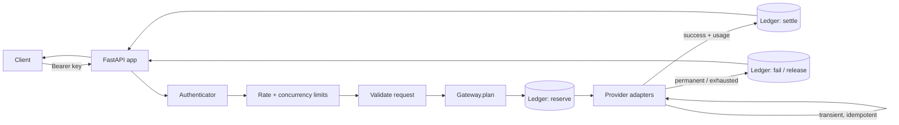

# Architecture

## Shape

One process, one SQLite file, one HTTP surface.

`Ledger` is the only component that touches SQLite. `Gateway` owns policy: it decides
whether a request may proceed, which targets to try, when to fall back, and how to settle.
`app.py` owns transport: auth header, body limits, error envelopes, metrics.

## Modules

| Module | Responsibility | Not responsible for |
| --- | --- | --- |
| `app.py` | HTTP surface, middleware, error mapping, metrics rendering | policy |
| `gateway.py` | planning, reservation, routing, fallback, settlement, traces | SQL |
| `ledger.py` | schema, transactions, budget math, usage reports, retention | provider calls |
| `providers.py` | adapter interface, HTTP clients, error classification, usage parsing | budgets |
| `limits.py` | process-local rate and concurrency limits | durable spend |
| `auth.py` | bearer parsing, SHA-256 digest comparison | session state |
| `redaction.py` | secret patterns, log sanitization, opt-in forwarding redaction | authorization |
| `tokens.py` | local token estimation for reservations | billing |
| `money.py` | decimal USD → integer micro-USD | rounding policy for providers |
| `config.py` | strict TOML parsing and validation | runtime state |
| `metrics.py` | in-process counters rendered as Prometheus text | durable history |
| `cli.py` | operator commands, exit codes | server internals |
| `loadtest.py` | concurrency test + reconciliation assertion | production traffic |

## Request lifecycle

1. **Body limit.** `Content-Length` and streamed bytes are capped by
   `server.max_body_bytes`; exceeding it is `413 payload_too_large`.
2. **Auth.** The bearer token is hashed and compared against every project's digests in
   constant time, so a timing observer cannot learn which project matched.
3. **Shaping.** Sliding-window rate limit, then the in-flight counter. Both are rejected
   immediately rather than queued: a queue would turn a budget problem into a latency
   problem.
4. **Validation.** Strict field set, message roles, `max_tokens` bounds, `stream` rejection,
   model allowlist, route existence.
5. **Reservation.** The worst-case cost is computed from the configured price table and the
   estimated input tokens, then written with the request row inside one `BEGIN IMMEDIATE`
   transaction. The transaction also re-reads committed spend, so the check and the write
   cannot be interleaved by another process.
6. **Forwarding.** Targets are tried in order. Each attempt is recorded with its own status,
   classification, latency, and cost.
7. **Settlement.** The first billable success settles the request at reported usage. All
   failures settle at zero and release the reservation.
8. **Evidence.** The response carries a `gateway` block; the ledger holds the same facts;
   metrics count them.

## Why the ledger is the source of truth

Budgets are durable state. Anything held only in memory (counters, rate-limit windows) is
allowed to be wrong after a restart, and the operations docs say so. Anything that decides
whether money may be spent is written to SQLite before the decision is acted on.

The ledger enforces three invariants:

- **Reserve before forward.** No provider call happens without a committed reservation.
- **Settle once.** Settlement is write-once per request; a second settlement is refused.
- **Reconcile.** `usage` compares each settled request's charge with the sum of its
  successful attempt costs. A mismatch is surfaced, not averaged away.

## Concurrency

SQLite in WAL mode with `synchronous=FULL` allows concurrent readers and serializes writers.
`BEGIN IMMEDIATE` takes the write lock at transaction start, so a budget check cannot be
based on a snapshot that another writer has already invalidated. Writers wait up to the busy
timeout; if the ledger is unavailable, the gateway fails closed (`503
budget_state_unavailable`) unless `server.fail_closed = false`.

Connections are pooled per process (up to 16 idle) and returned on context exit. The
pool exists because a fresh connection per transaction costs a schema read plus pragma work;
it does not change the isolation model.

Rate and concurrency limits are in-process, by design: they shape load, they do not protect
the budget. See [decisions/0004-process-local-limits.md](decisions/0004-process-local-limits.md).

## Failure classification

| Condition | Class | Fallback? |
| --- | --- | --- |
| Connection error, DNS failure, socket timeout | transient | yes, if idempotent |
| HTTP `408`, `429`, `5xx` | transient | yes, if idempotent |
| HTTP `4xx` (other) | permanent | no |
| Malformed / unparseable body | permanent | no |
| Timeout after the request was sent, no usage | transient, reservation released | yes, if idempotent |

A timeout is the ambiguous case: the provider may have billed without returning usage
evidence. The gateway releases the reservation, records `upstream_timeout`, and does not
charge. This can under-count spend; it never over-counts it. See
[decisions/0003-reserve-then-settle.md](decisions/0003-reserve-then-settle.md).

## Storage schema (v1)

| Table | Contents |
| --- | --- |
| `projects` | project id, budgets, policy snapshot for reporting |
| `requests` | one row per accepted request: route, reservation, settled cost, status |
| `attempts` | one row per provider attempt: provider, model, status, tokens, cost, latency |
| `audit_events` | fail-open, overage, retention purge, and other operator-relevant events |

Rows are keyed by opaque ids (`req_…`, `att_…`). Prompt text is not stored.
